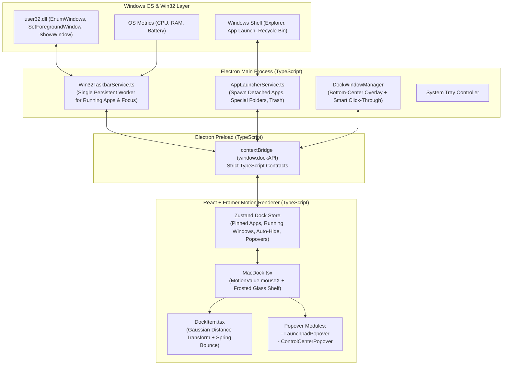

# Arsitektur Teknis (Technical Architecture) — TASK BAR IOS / macOS Dock

Dokumen ini menjelaskan arsitektur teknis **TASK BAR IOS** untuk Windows yang dirancang menggunakan **TypeScript**, dengan fokus pada **animasi pembesaran ikon 60 FPS tanpa *React Re-render*** dan **konsumsi RAM ultra-rendah**.

---

## 1. Diagram Arsitektur Sistem



---

## 2. Rahasia Performa: Magnification 60 FPS Tanpa React Re-Render

Kesalahan paling umum saat membuat macOS Dock di React adalah menyimpan posisi `mouseX` di dalam `useState()`. Itu akan memicu *re-render* seluruh pohon komponen React 60 kali per detik setiap kali mouse bergeser 1 piksel, menyebabkan *lag* dan lonjakan CPU/RAM.

**Solusi Arsitektur Kami (`useMotionValue` + `useTransform` + `useSpring`):**
1. Posisi kursor horizontal disimpan di dalam `const mouseX = useMotionValue(Infinity)`.
2. Setiap `DockItem` membaca jarak pusat ikon ke `mouseX` secara langsung di luar siklus render React menggunakan `useTransform(mouseX, (val) => ...)`.
3. Lebar ikon (`width` dan `height`) dihaluskan menggunakan fisika pegas `useSpring(widthTransform, { mass: 0.1, stiffness: 170, damping: 12 })`.
4. **Hasilnya:** **0 React Re-render** saat kursor digerakkan di sepanjang Dock! Beban CPU tetap mendekati 0% dan animasi sangat mulus seperti macOS asli.

---

## 3. Mekanisme Window & "Smart Click-Through" di Bawah Layar

1. `BrowserWindow` diletakkan di bagian **tengah bawah layar (`Bottom-Center`)** dengan ukuran kanvas tetap (misal `width: 960px`, `height: 240px`) agar saat ikon membesar ke atas atau ketika popover terbuka, tidak terpotong oleh batas window.
2. Area transparan di atas dan di samping Dock diatur **tembus klik** (`mainWindow.setIgnoreMouseEvents(true, { forward: true })`) sehingga tidak menghalangi klik pada aplikasi atau taskbar di belakangnya.
3. Saat kursor menyentuh kapsul Dock (`onMouseEnter`) atau garis sensor Auto-Hide di dasar layar, Renderer memanggil `dockAPI.setIgnoreMouseEvents(false)` agar seluruh ikon dan popover dapat diklik.

---

## 4. Kontrak Data TypeScript (`src/shared/types.ts`)

```typescript
export type DockAppCategory = 'system' | 'pinned' | 'running' | 'utility';

export interface DockAppItem {
  id: string;
  name: string;
  iconType:
    | 'finder'
    | 'launchpad'
    | 'browser'
    | 'code'
    | 'terminal'
    | 'music'
    | 'settings'
    | 'folder'
    | 'control'
    | 'trash'
    | 'custom';
  command: string;          // Path .exe, URI, atau perintah internal
  args?: string[];
  processName?: string;     // Nama proses Windows (misal 'Code', 'chrome', 'explorer')
  isPinned: boolean;
}

export interface RunningWindowInfo {
  pid: number;
  processName: string;
  windowTitle: string;
  hwnd: number;
  executablePath?: string;
}

export interface DockSystemStatus {
  cpuPercent: number;
  ramPercent: number;
  appRamMB: number;
  batteryPercent: number;
  isCharging: boolean;
}

export interface DockElectronAPI {
  setIgnoreMouseEvents: (ignore: boolean) => void;
  launchApp: (item: DockAppItem) => Promise<boolean>;
  focusOrToggleWindow: (pid: number, hwnd: number) => Promise<boolean>;
  closeWindow: (pid: number) => Promise<boolean>;
  openSpecialFolder: (folder: 'downloads' | 'documents' | 'recyclebin' | 'explorer') => Promise<void>;
  onRunningAppsUpdate: (callback: (apps: RunningWindowInfo[]) => void) => () => void;
  onSystemStatusUpdate: (callback: (status: DockSystemStatus) => void) => () => void;
  getInitialData: () => Promise<{
    runningApps: RunningWindowInfo[];
    systemStatus: DockSystemStatus;
  }>;
}
```

---

## 5. Strategi Penghematan RAM (Ultra-Low Memory)
1. **V8 Heap Cap:** `--js-flags="--max-old-space-size=64"` di `electron/main.ts`.
2. **Pemangkasan Fitur Chromium:** Mematikan `webgl`, `spellcheck`, `http-cache`, dan `extensions`.
3. **Single Persistent Win32 Worker:** Deteksi jendela aktif Windows (`Get-Process`) dan manipulasi fokus jendela (`user32.dll` `SetForegroundWindow`, `ShowWindow`) dijalankan melalui **1 worker stream persisten** tanpa pernah men-*spawn* proses PowerShell baru.
4. **DOM Minimalis:** Popover (*Launchpad* dan *Control Center*) hanya di-*mount* ke DOM saat sedang dibuka oleh pengguna.

---

## 6. Struktur Folder Proyek (`TASK BAR IOS`)

```text
D:\vnotch_dynmic_island\TASK BAR IOS\
├── docs/
│   ├── PRD.md                  # Product Requirements Document
│   ├── ARCHITECTURE.md         # Arsitektur Teknis & Optimasi RAM
│   └── FLOW_AND_PLAN.md        # Alur Fisika Magnification, State, & Roadmap
├── electron/
│   ├── main.ts                 # Entry point Electron Main Process (Bottom-Center Window)
│   ├── preload.ts              # ContextBridge API (window.dockAPI)
│   └── services/
│       ├── Win32TaskbarService.ts # Persistent Worker: Deteksi Window & Focus/Minimize
│       └── AppLauncherService.ts  # Eksekusi Aplikasi, Folder Khusus, & Recycle Bin
├── scripts/
│   └── build-exe.mjs           # Script pembungkus Portable .exe
├── src/
│   ├── shared/
│   │   └── types.ts            # Interface TypeScript bersama
│   ├── store/
│   │   └── useDockStore.ts     # State management (Pinned Apps, Running Apps, Settings)
│   ├── components/
│   │   ├── MacDock.tsx         # Kontainer utama Dock + Auto-Hide sensor
│   │   ├── DockItem.tsx        # Komponen ikon dengan fisika Parabolic Magnification
│   │   ├── LaunchpadModal.tsx  # Grid peluncur aplikasi cepat ala macOS Launchpad
│   │   └── ControlCenter.tsx   # Popover pengaturan Dock (Auto-hide, Ukuran, Info RAM)
│   ├── App.tsx
│   ├── main.tsx
│   └── index.css               # Glassmorphism & animasi Bounce CSS
├── index.html
├── package.json
├── tsconfig.json
├── tsconfig.electron.json
└── vite.config.ts
```
