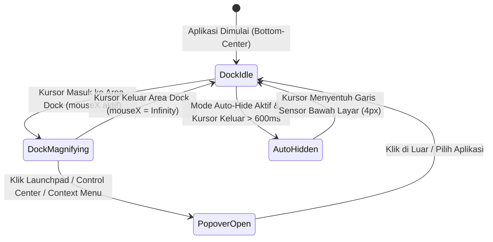
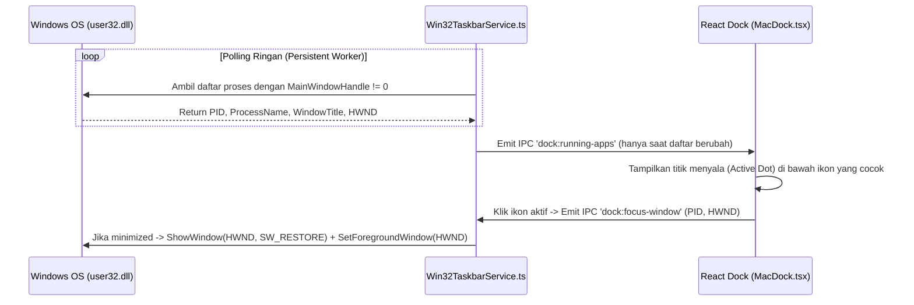
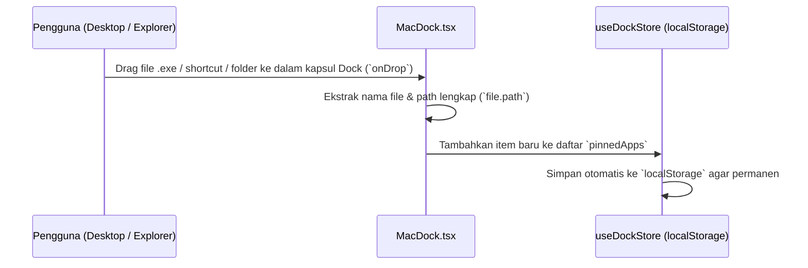

# Alur Interaksi, Fisika Magnification, & Rencana Eksekusi (PLAN) — TASK BAR IOS

Dokumen ini merinci **Rumus Fisika Magnification Dock**, **State Machine**, **Alur Kerja Integrasi Windows**, serta **Tahapan Pembangunan (Implementation Plan)**.

---

## 1. Rumus Fisika Parabolic Magnification (macOS Dock Curve)

Saat kursor bergerak secara horizontal pada koordinat $x_{\text{mouse}}$, setiap ikon ke-$i$ memiliki titik pusat horizontal $x_i$.
Jarak antara kursor dan titik pusat ikon adalah:

$$d_i = x_{\text{mouse}} - x_i$$

Dalam jangkauan radius pengaruh $R = 140\text{ px}$:
* Jika $|d_i| \ge R$, maka ukuran ikon tetap pada ukuran dasar $S_{\text{base}} = 48\text{ px}$.
* Jika $|d_i| < R$, ukuran ikon diinterpolasi dari domain $[-140, 0, 140]$ ke rentang $[S_{\text{base}}, S_{\text{max}}, S_{\text{base}}]$ (di mana $S_{\text{max}} = 76\text{ px}$) dan diteruskan ke pegas *Spring* (`mass: 0.1`, `stiffness: 170`, `damping: 12`).

---

## 2. State Machine TASK BAR IOS

---

## 3. Alur Kerja (Sequence Diagrams)

### A. Alur Deteksi & Fokus Jendela Aplikasi Windows

### B. Alur Pin Aplikasi Baru (Drag & Drop ke Dock)

---

## 4. Rencana Tahapan Eksekusi (Step-by-Step Build Plan)

1. **Tahap 1 — Setup Proyek TypeScript di Folder `TASK BAR IOS`:**
   * Konfigurasi `package.json`, `tsconfig.json`, `tsconfig.electron.json`, `vite.config.ts`, dan Tailwind CSS.
2. **Tahap 2 — Pembuatan Window Bottom-Center & Smart Click-Through (`electron/main.ts`):**
   * Meletakkan window transparan tepat di tengah bawah layar utama (`Bottom-Center`), `alwaysOnTop` level `'screen-saver'`, dengan optimasi hemat RAM (`--max-old-space-size=64`).
3. **Tahap 3 — Layanan Integrasi Windows (`Win32TaskbarService.ts` & `AppLauncherService.ts`):**
   * Pembuatan *persistent worker* untuk membaca daftar aplikasi Windows yang sedang berjalan, memfokuskan/minimize jendela (`SetForegroundWindow` / `ShowWindow`), serta meluncurkan aplikasi/folder/Recycle Bin.
4. **Tahap 4 — Implementasi Komponen Inti macOS Dock (`MacDock.tsx` & `DockItem.tsx`):**
   * Pembuatan kontainer *Frosted Glassmorphism*, garis pemisah (*Divider*), fisika *Parabolic Magnification* 60 FPS, animasi *Bounce* saat klik, dan *Tooltip* melayang.
5. **Tahap 5 — Implementasi Popover (`LaunchpadModal.tsx`, `ControlCenter.tsx`, & Context Menu):**
   * Menu *Launchpad* bergaya iOS/macOS, *Control Center* (pengaturan *Auto-Hide*, ukuran Dock, monitor CPU/RAM/Baterai), dan dukungan *Drag-and-Drop Pinning*.
6. **Tahap 6 — Kompilasi, Pengujian, & Packaging `.exe`:**
   * Verifikasi kompilasi TypeScript dan pembungkusan menjadi file *standalone executable* (`iOSTaskbarDock.exe`).
