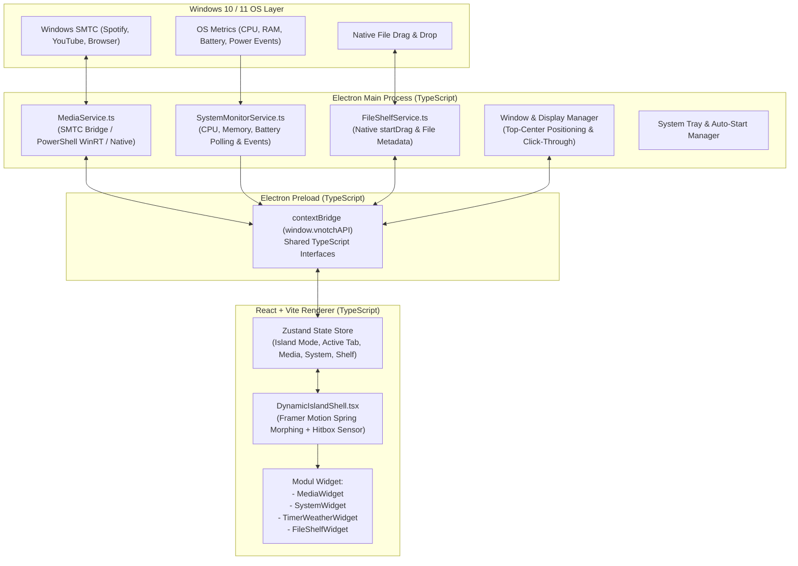

# Arsitektur Teknis (Technical Architecture) — VNotch Dynamic Island

Dokumen ini menjelaskan rancangan arsitektur sistem **VNotch Dynamic Island** yang dibangun menggunakan **TypeScript** secara menyeluruh (*end-to-end type-safe*) mulai dari proses belakang layar (*Electron Main Process*), jembatan komunikasi (*Preload Script*), hingga antarmuka pengguna (*React Renderer*).

---

## 1. Diagram Arsitektur Tingkat Tinggi



---

## 2. Mekanisme Window & "Smart Click-Through" di Windows

Salah satu tantangan utama membuat *Dynamic Island* di Windows menggunakan Electron adalah:
* Jika ukuran `BrowserWindow` diubah-ubah secara dinamis setiap frame (`win.setBounds`), Windows akan menampilkan efek *flicker* atau jeda render.
* **Solusi Arsitektur (Fixed Canvas + Dynamic Hitbox):**
  1. `BrowserWindow` dibuat dengan ukuran kanvas tetap di bagian tengah atas layar (misalnya lebar `600px` x tinggi `280px`), sepenuhnya **transparan** (`transparent: true`, `frame: false`, `alwaysOnTop: true`, `skipTaskbar: true`, `resizable: false`).
  2. Secara default, `win.setIgnoreMouseEvents(true, { forward: true })` diaktifkan sehingga seluruh area transparan di luar *pill* hitam **tembus klik** (*click-through*) ke aplikasi di belakangnya (seperti tab Chrome di atas layar).
  3. Di dalam React (`DynamicIslandShell.tsx`), ketika kursor masuk ke elemen kapsul (`onMouseEnter`) atau saat ada file yang di-drag mendekati area kapsul, Renderer mengirim sinyal IPC `vnotch:set-ignore-mouse(false)` sehingga kapsul dapat diklik dan diinteraksikan.
  4. Saat kursor keluar dari kapsul (`onMouseLeave`), Renderer mengirim `vnotch:set-ignore-mouse(true)` agar area sekeliling kembali tembus klik.

---

## 3. Kontrak Data TypeScript (`src/shared/types.ts`)

Seluruh komunikasi antara *Main Process* dan *Renderer* menggunakan satu sumber tipe data (*Single Source of Truth*) di `src/shared/types.ts`:

```typescript
// Mode ukuran kapsul Dynamic Island
export type IslandSizeMode = 'compact' | 'peek' | 'expanded' | 'alert';

// Tab aktif saat mode Expanded
export type IslandTab = 'media' | 'system' | 'timer' | 'shelf';

// Data Sesi Media (Spotify, YouTube, Browser, dll.)
export interface MediaSessionData {
  isPlaying: boolean;
  title: string;
  artist: string;
  album?: string;
  appId: string; // contoh: 'Spotify.exe', 'chrome.exe', 'msedge.exe'
  sourceType: 'spotify' | 'youtube' | 'browser' | 'music' | 'unknown';
  thumbnailUrl?: string; // Base64 data URI atau URL
  positionSeconds?: number;
  durationSeconds?: number;
}

// Data Statistik Sistem & Baterai
export interface SystemStatsData {
  cpuUsagePercent: number;
  ramUsagePercent: number;
  ramUsedGB: number;
  ramTotalGB: number;
  battery: {
    hasBattery: boolean;
    percent: number;
    isCharging: boolean;
  };
  timestamp: number;
}

// Item pada File Tray / Dropzone
export interface ShelfFileItem {
  id: string;
  name: string;
  path: string;
  sizeBytes: number;
  extension: string;
  addedAt: number;
}

// Notifikasi / HUD Alert sementara
export interface IslandAlertPayload {
  id: string;
  type: 'battery-charging' | 'battery-low' | 'timer-done' | 'media-change' | 'system-warn';
  title: string;
  subtitle?: string;
  icon?: string;
  durationMs?: number;
}
```

---

## 4.Daftar Channel IPC (Inter-Process Communication)

| Nama Channel | Arah | Deskripsi |
| :--- | :--- | :--- |
| `vnotch:set-ignore-mouse` | Renderer -> Main | Mengatur apakah kursor menembus window (`ignore: boolean`) |
| `vnotch:set-polling-mode` | Renderer -> Main | Mengatur frekuensi polling (`'idle' \| 'active'`) demi menghemat RAM & CPU |
| `vnotch:media-update` | Main -> Renderer | Mengirim update lagu/video terbaru dari Windows SMTC |
| `vnotch:media-control` | Renderer -> Main | Mengirim perintah `'play-pause' \| 'next' \| 'previous'` ke sistem |
| `vnotch:system-update` | Main -> Renderer | Mengirim metrik CPU, RAM, dan Baterai setiap 2 detik |
| `vnotch:power-event` | Main -> Renderer | Event instan saat charger dicolokkan (`on-ac`) atau dilepas (`on-battery`) |
| `vnotch:shelf-start-drag` | Renderer -> Main | Memicu `webContents.startDrag()` agar file di Shelf bisa di-drag keluar ke aplikasi Windows lain |

---

## 5. Strategi Optimasi Hemat RAM & CPU (Ultra-Low Memory Architecture)

Agar aplikasi **tidak memakan banyak RAM** meskipun berjalan terus-menerus di latar belakang Windows, arsitektur ini menerapkan 5 teknik penghematan memori secara ketat:

### 5.1. Pembatasan Memori V8 & Pemangkasan Fitur Chromium (`electron/main.ts`)
Sebelum `app.whenReady()`, Electron dikonfigurasi dengan *command line switches* khusus untuk mematikan fitur browser yang tidak dibutuhkan oleh *overlay widget*:
* `app.commandLine.appendSwitch('js-flags', '--max-old-space-size=64 --expose-gc')` — Membatasi *V8 JavaScript Heap* maksimal **64 MB** sehingga *Garbage Collector* langsung membersihkan objek yang tidak terpakai.
* `app.commandLine.appendSwitch('disable-http-cache')` & `disk-cache-size=1` — Menghindari pembengkakan cache memori/disk.
* `app.commandLine.appendSwitch('disable-extensions')` & `disable-background-networking`.
* Pada `BrowserWindow.webPreferences`: `spellcheck: false`, `webgl: false`, `enableWebSQL: false` (menghemat **40–80 MB** RAM karena tidak memuat kamus *spellcheck* dan buffer 3D WebGL).

### 5.2. Zero Process-Spawning pada Sistem Monitoring (`SystemService.ts`)
* **DILARANG** memanggil `exec('powershell ...')` atau `wmic` berulang-ulang setiap beberapa detik (karena setiap spawn process baru memakan 40–60 MB RAM sementara).
* **Solusi:**
  * Penggunaan **CPU & RAM** dihitung 100% menggunakan modul bawaan C++ Node.js (`os.cpus()`, `os.totalmem()`, `os.freemem()`) yang berjalan di memori dalam hitungan mikrodetik (**0 MB ekstra RAM**).
  * Untuk pembacaan sesi media Windows (SMTC), digunakan **1 worker stream persisten** atau pembacaan ringan yang langsung tidur (*idle*) ketika tidak ada perubahan.

### 5.3. Adaptive Polling (Polling Pintar Berdasarkan State UI)
* Saat VNotch berada di mode **Compact (Idle)**, pengiriman detail statistik sistem dipangkas ke interval lambat (**10 detik sekali**).
* Saat pengguna membuka mode **Expanded -> Tab System**, interval otomatis naik menjadi *real-time* (**1.5 detik sekali**), dan kembali melambat begitu kapsul tertutup.

### 5.4. DOM Unmounting & Pembersihan Memori Otomatis
* Ketika kapsul dalam mode **Compact**, seluruh komponen berat di dalam mode **Expanded** (`MediaWidget`, `SystemWidget`, `TimerWeatherWidget`, `FileShelfWidget`) **di-unmount sepenuhnya dari DOM React** (hanya menyisakan < 15 node HTML untuk kapsul kecil).
* Setiap kali kapsul menutup dari `Expanded` ke `Compact`, aplikasi memicu pembersihan referensi gambar/thumbnail yang sudah lewat.

### 5.5. Animasi Berbasis CSS Compositor (Tanpa JS Frame Loop)
* Gelombang suara (*Audio Waveform Visualizer*) menggunakan animasi murni CSS `@keyframes` dengan properti `transform: scaleY(...)` yang dirender langsung oleh GPU Compositor tanpa membebani *Main Thread* JavaScript atau mengalokasikan `<canvas>` bitmap.

---

## 6. Struktur Direktori Proyek

```text
D:\vnotch_dynmic_island\
├── docs/
│   ├── PRD.md                  # Product Requirements Document
│   ├── ARCHITECTURE.md         # Arsitektur Teknis & Kontrak TypeScript
│   └── FLOW_AND_STATES.md      # Alur Pengguna & State Machine Animasi
├── electron/
│   ├── main.ts                 # Entry point Electron Main Process (Window, Tray, PowerMonitor)
│   ├── preload.ts              # ContextBridge API untuk React Renderer
│   └── services/
│       ├── MediaService.ts     # Integrasi Windows SMTC (Spotify, YouTube, Browser)
│       ├── SystemService.ts    # Monitoring CPU, RAM, & Baterai
│       └── FileShelfService.ts # Handler Native Drag-Out File
├── src/
│   ├── shared/
│   │   └── types.ts            # Definisi Interface TypeScript bersama (Main & Renderer)
│   ├── store/
│   │   └── useIslandStore.ts   # State management terpusat (Zustand)
│   ├── components/
│   │   ├── DynamicIsland.tsx   # Komponen utama kapsul dengan animasi Framer Motion
│   │   ├── CompactView.tsx     # Tampilan saat kapsul mengecil (Idle / Live Activity)
│   │   ├── PeekView.tsx        # Tampilan saat di-hover sebentar
│   │   ├── AlertView.tsx       # Tampilan HUD pop-up (Charger, Timer selesai, dll.)
│   │   └── widgets/
│   │       ├── MediaWidget.tsx       # Kontroler Spotify / YouTube + Audio Visualizer
│   │       ├── SystemWidget.tsx      # Grafik/Ring CPU, RAM, & Baterai
│   │       ├── TimerWeatherWidget.tsx# Jam, Countdown Timer, Stopwatch, & Cuaca
│   │       └── FileShelfWidget.tsx   # Keranjang Drag & Drop File sementara
│   ├── App.tsx
│   ├── main.tsx
│   └── index.css               # Tailwind CSS & utilitas animasi gelombang suara
├── index.html
├── package.json
├── tsconfig.json
└── vite.config.ts
```
