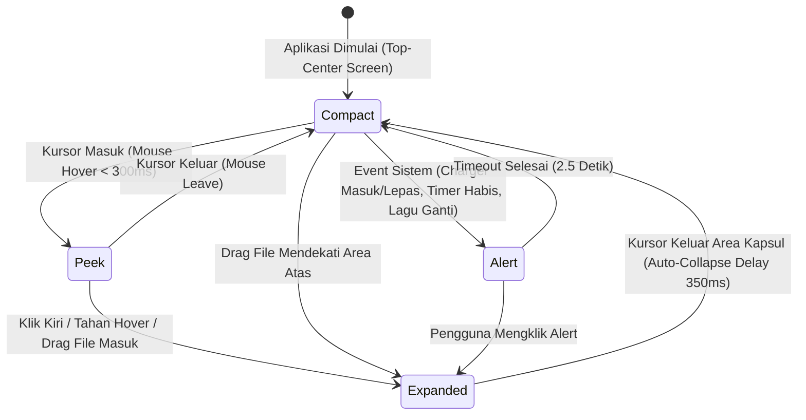
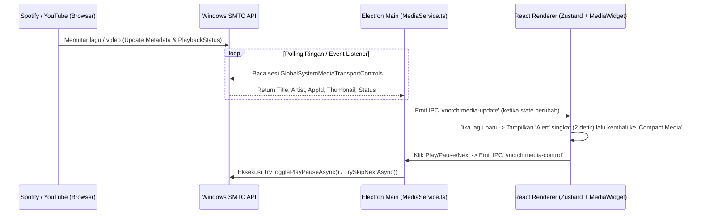
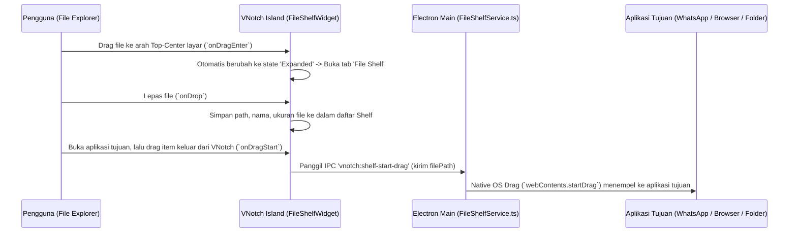

# Alur Interaksi & State Machine (Flow & States) — VNotch Dynamic Island

Dokumen ini memetakan **State Machine**, **Alur Interaksi Pengguna (User Flow)**, **Spesifikasi Dimensi & Animasi Spring**, serta **Tahapan Eksekusi Pembangunan (Roadmap)** agar implementasi berjalan terstruktur.

---

## 1. Diagram State Machine Kapsul (Island States)

---

## 2. Spesifikasi Dimensi & Fisika Animasi (Spring Physics)

Untuk meniru rasa elastis (*fluid spring*) seperti di iOS, setiap perubahan *state* menggunakan `framer-motion` dengan konfigurasi *spring* (`stiffness: 380`, `damping: 28`, `mass: 0.8`):

| State Mode | Lebar (`width`) | Tinggi (`height`) | Border Radius | Konten yang Ditampilkan |
| :--- | :--- | :--- | :--- | :--- |
| **1. Compact (Idle)** | `180px` | `36px` | `20px` | Jam digital di kiri, indikator status baterai/CPU titik hijau di kanan. |
| **2. Compact (Media Active)** | `230px` | `36px` | `20px` | *Mini Album Art* berputar/statis di kiri, judul singkat di tengah, *Audio Waveform* bergerak di kanan. |
| **3. Compact (Media + Timer)** | `270px` | `36px` | `20px` | *Album Art* + *Waveform* di sisi kiri, *Countdown Timer* warna oranye di sisi kanan. |
| **4. Peek (Hovered)** | `310px` | `52px` | `26px` | Preview cepat lagu yang sedang diputar + tombol Play/Pause cepat + indikator tab. |
| **5. Alert / HUD Toast** | `320px` | `58px` | `29px` | Animasi ikon (misal: petir hijau saat *Charging*, lonceng saat *Timer Done*, atau *Track Changed*). |
| **6. Expanded (Full Panel)** | `460px` | `215px` | `34px` | Navigasi 4 Tab (**Media**, **System**, **Timer & Weather**, **File Shelf**) beserta isi widget lengkapnya. |

---

## 3. Alur Kerja Fitur Utama (Feature Flows)

### A. Alur Deteksi Media (Spotify, YouTube, Browser)

### B. Alur File Tray / Dropzone (Drag & Drop Sementara)

---

## 4. Roadmap Implementasi (Step-by-Step Execution Plan)

1. **Tahap 1 — Inisialisasi Proyek TypeScript & Konfigurasi Electron + Vite:**
   * Setup `package.json`, `tsconfig.json`, `vite.config.ts`, dan Tailwind CSS.
   * Membuat struktur folder `electron/`, `src/shared/`, `src/store/`, dan `src/components/`.
2. **Tahap 2 — Pembuatan Window Overlay & Smart Click-Through:**
   * Implementasi `electron/main.ts` untuk meletakkan window tepat di tengah atas layar utama (`Top-Center`), `alwaysOnTop` level `'screen-saver'`, transparan, dan mekanisme `setIgnoreMouseEvents`.
3. **Tahap 3 — Backend Services (TypeScript Main Process):**
   * `MediaService.ts`: Pembacaan sesi media Windows SMTC (Spotify, Chrome/YouTube, Edge, dll.) + kontrol *Play/Pause/Next/Prev*.
   * `SystemService.ts`: Perhitungan real-time penggunaan CPU, RAM, serta pembacaan status baterai & event colok/lepas charger (`powerMonitor`).
   * `FileShelfService.ts`: Handler native drag-and-drop keluar untuk File Tray.
4. **Tahap 4 — Frontend Core & Animasi Spring (`DynamicIsland.tsx`):**
   * State management dengan Zustand (`useIslandStore.ts`).
   * Implementasi cangkang kapsul dengan Framer Motion (`Compact`, `Peek`, `Alert`, `Expanded`) + *Audio Waveform Visualizer*.
5. **Tahap 5 — Implementasi 4 Widget Utama:**
   * `MediaWidget.tsx` (Spotify/YouTube controller + ambient glow).
   * `SystemWidget.tsx` (CPU/RAM/Battery gauges & quick stats).
   * `TimerWeatherWidget.tsx` (Live countdown timer, stopwatch, & cuaca).
   * `FileShelfWidget.tsx` (Dropzone keranjang file sementara).
6. **Tahap 6 — Pengujian & Penyempurnaan UI/UX:**
   * Verifikasi kompilasi TypeScript (`tsc --noEmit`), build, dan uji coba langsung di layar Windows.
